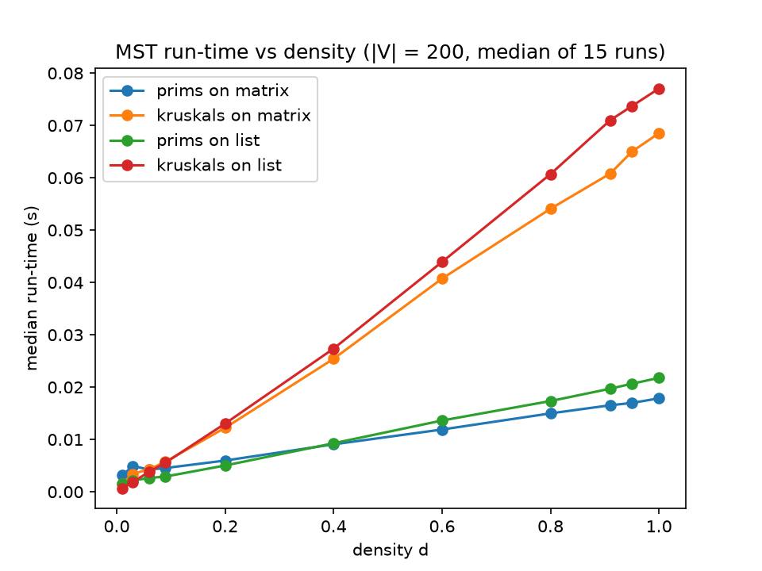
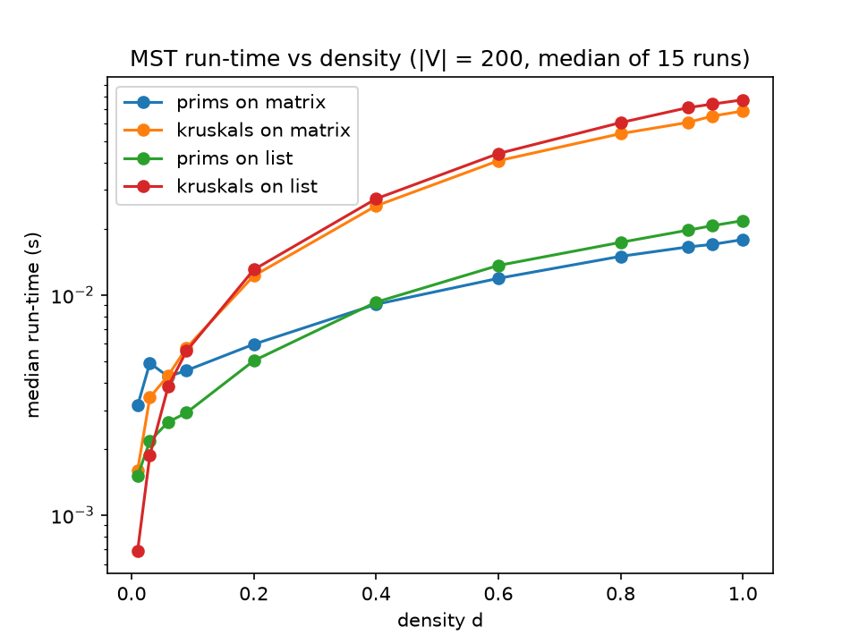

# Minimum Spanning Tree Algorithms: Which One Is Fastest?

An experiment comparing **Prim's** and **Kruskal's** algorithms on two graph representations (**adjacency list** and **adjacency matrix**) to find out how graph density changes which combination performs best.

Built in Python as part of my Master's in Data Science.

## The question

Both algorithms find a minimum spanning tree, but they read the graph differently. Theory says the best choice should depend on how many edges the graph has. This project tests that claim with a controlled timing experiment instead of taking it on trust.

## Approach

**1. Complexity analysis.** I worked out the time complexity for each combination first, so the results could be checked against a prediction:

| Combination | Complexity |
|---|---|
| Kruskal's + adjacency list | Θ(\|E\| log \|E\|) |
| Kruskal's + adjacency matrix | Θ(\|V\|² + \|E\| log \|E\|) |
| Prim's + adjacency list | Θ(\|E\| log \|V\|) |
| Prim's + adjacency matrix | Θ(\|V\|² + \|E\| log \|V\|) |

The \|V\|² term comes from scanning the full matrix, even when few edges exist.

**2. Experiment design.**
- Fixed the graph at **200 nodes** and varied only the **density** (edges as a fraction of all possible edges).
- Tested **11 densities** from 0.01 to 1.0, with extra points at the sparse and dense ends where the interesting changes happen.
- Used the **same seeded graph** for all four combinations at each density, so differences come from the algorithm and representation, not the input.
- Per combination: one discarded warm-up run, then **15 timed runs**, reporting the **median** to reduce the effect of outliers.
- Disabled garbage collection during timing to avoid random pauses.
- **Correctness check:** confirmed all four combinations returned the same total tree weight at every density.

## Results




The right-hand plot uses a log scale so the sparse region (d < 0.1) is readable.

**Key findings**
- **Kruskal's slows down quickly as density rises**, from under 1 ms at d = 0.01 to about 70 ms at d = 1.0, because it must sort every edge.
- **Prim's grows much more slowly**, reaching about 20 ms at d = 1.0. Its worst-case bound is the same class as Kruskal's, but in practice many decrease-key calls leave the heap unchanged.
- **The best choice changes with density.** Kruskal's on a list is fastest at the very sparsest density (d = 0.01), but by about d = 0.06, Prim's on a list takes over.
- **Dense graphs (d > 0.9):** Prim's is about **4x faster** than Kruskal's. Prim's on a matrix is about 20% faster than on a list.
- **Matrix versions are about 2x slower on sparse graphs**, since they scan the whole grid, and the gap shrinks as density grows.

**Recommendation:** Prim's on an adjacency list for sparse networks (it stays close to the best across the whole range), and Prim's for dense networks, where the matrix is slightly faster if you are choosing a representation from scratch.

## Project structure

```
graph/                Adjacency list and matrix representations
mst/                  Prim's and Kruskal's implementations
utils/                Helper functions
visuals/              Plotting code
tests/                Tests
initiateOperation.py  Entry point to run the experiment
example_config.json   Example configuration
requirements.txt      Python dependencies
task_c_plot.png       Results (linear scale)
task_c_plot_log.png   Results (log scale)
```

## How to run

Tested with Python 3.13.7.

```bash
pip install -r requirements.txt
python initiateOperation.py example_config.json experiment
```

## What I learned

- How to design a fair benchmark: fixing variables, seeding data, warming up, repeating runs and using the median.
- That theoretical complexity and real performance can differ, and that worst-case bounds do not always describe typical behaviour.
- How to turn raw timings into a clear recommendation, including where the choice is obvious and where it is close.

## Tools

Python, Matplotlib, data structures and algorithm analysis

---

